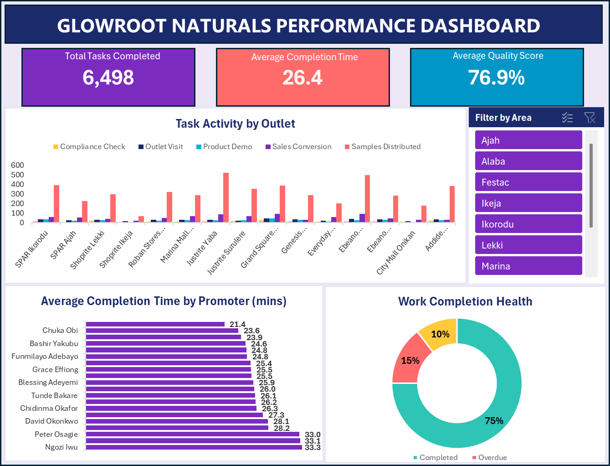

# 🧴 GlowRoot Naturals — Field Activation Performance Dashboard
## 📊 Excel Dashboard Capstone Project

---

# 📖 Project Overview

This project was completed as a hands-on data analytics capstone, applying the complete Excel analytics workflow to a real-world business scenario.

GlowRoot Naturals is a skincare and haircare brand running an in-store promoter campaign across multiple retail outlets in Lagos, Nigeria. With promoters logging daily activity across different task types, statuses, and locations, the Trade Marketing team needed a clear, one-page view of where field effort is going, how efficiently promoters are working, and how much logged activity is actually getting completed.

This project takes the raw task-level activity log and turns it into a clean, interactive, single-page Excel dashboard built for a client review.

---

# 🎯 Project Objective

The objective of this project was to apply the complete data analytics workflow to solve a real business problem by:

- Validating and preparing a raw dataset
- Verifying data quality rather than assuming it
- Building PivotTable-driven KPIs and visuals
- Answering specific business questions through analysis
- Designing a clean, decision-ready dashboard for a non-technical audience

---

# 📂 Dataset

The project uses the **GlowRoot Naturals Field Activity Dataset** — a task-level activity log containing:

- 1,506 logged tasks
- 20 promoters
- 10 areas across Lagos
- 15 retail outlets
- 5 task types (Outlet Visit, Product Demo, Samples Distributed, Compliance Check, Sales Conversion)
- Date range: April 6 – May 16, 2026

---

# 🛠 Tools Used

- 📊 Microsoft Excel
- 📐 PivotTables & PivotCharts
- 🧮 DAX-style aggregation via GETPIVOTDATA
- 🎛 Slicers
- 🎨 Custom dashboard design & formatting

---

# 🧹 Data Cleaning & Preparation

Rather than assume the dataset was analysis-ready, a full validation pass was carried out and documented:

- Converted the raw range into a structured Excel Table (`tblFieldData`)
- Checked for duplicate log entries using Remove Duplicates and a COUNTIFS cross-check
- Checked for blank rows and cells
- Confirmed the Date column was stored as a true date type, not text
- Verified all numeric fields (Tasks Completed, Completion Time, Quality Score) for valid ranges
- Checked every text field (Promoter Name, Area, Outlet Name, Task Type, Status) for extra spacing using `LEN()`/`TRIM()` comparisons
- Reviewed each text column for capitalization and spelling consistency
- Result: the dataset passed all checks, confirming it was clean and standardized for analysis

---

# 📊 Dashboard — Field Activation Performance Dashboard

### KPIs

- ✅ Total Tasks Completed — 6,498
- ⏱ Average Completion Time — 26.4 minutes
- ⭐ Average Quality Score — 76.9%

### Visualizations

- **Activity Concentration** — Clustered Column Chart (Outlet Name × Task Type)
- **Promoter Efficiency** — Bar Chart (Average Completion Time by Promoter)
- **Work Completion Health** — Donut Chart (Completed vs Overdue vs Pending)
- **Area Slicer** — connected to all visuals for synchronized filtering

### Key Findings

- Justrite Yaba, Ebeano Supermarket Lekki, and Grand Square Ikeja generate the highest field activity.
- Samples Distributed is the leading task type across the top-performing outlets.
- Ngozi Iwu, Segun Ogundipe, and Peter Osagie take noticeably longer per task (~33 mins) versus the 26.4-minute team average.
- 75.0% of logged tasks are completed, while 14.5% are overdue and 10.4% are pending.

---

# 📈 Insights

- Field activity is unevenly distributed, with the top 3 outlets generating almost 3x the activity of the bottom 3.
- A small group of promoters consistently runs above the team's average completion time.
- Nearly a quarter of all logged tasks are not yet completed, pointing to a follow-up process gap.

---

# 💡 Recommendations

- Investigate why low-activity outlets like Shoprite Ikeja generate significantly less task volume — this may reflect staffing, footfall, or scheduling gaps.
- Provide targeted coaching or review task allocation for promoters consistently running above the average completion time.
- Strengthen the task follow-up process to reduce the Overdue and Pending share, currently at nearly 25% of all logged activity.
- Continue tracking these KPIs weekly to monitor whether completion health improves over time.

---

# ⚠️ Project Note

The **Total Tasks Completed** KPI reflects the sum of all logged tasks across every status (Completed, Overdue, and Pending), not only finished work. This definition was chosen to stay consistent with the Activity Concentration pivot and to represent total field effort, and is labeled accordingly on the dashboard.

---

# 📚 Skills Demonstrated

- Data Validation & Cleaning
- Excel Tables & Structured References
- PivotTables & PivotCharts
- KPI Design
- Slicer-driven Interactivity
- Dashboard Design
- Data Visualization
- Business Insight Generation
- Technical Documentation

---

# 📌 Conclusion

This project demonstrates the complete Excel analytics workflow — from validating a raw dataset to building an interactive, decision-ready dashboard. By transforming a task-level activity log into clear KPIs and visuals, the dashboard enables GlowRoot Naturals' Trade Marketing team to quickly identify where field effort is concentrated, which promoters need support, and how much logged work is actually being completed.

---

## 👩‍💻 Developed By

**Esther Jimbo**

Field Activation Performance Dashboard — Excel Capstone Project

---

#Excel #DataAnalytics #PivotTables #DataVisualization #Dashboard #PortfolioProject
